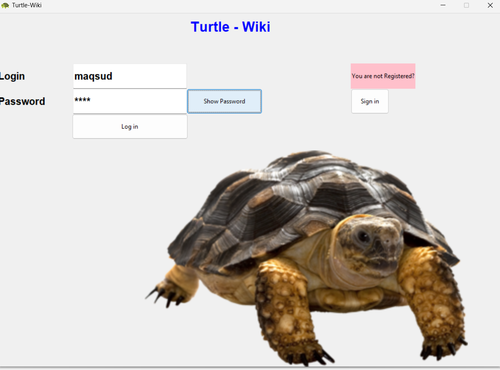
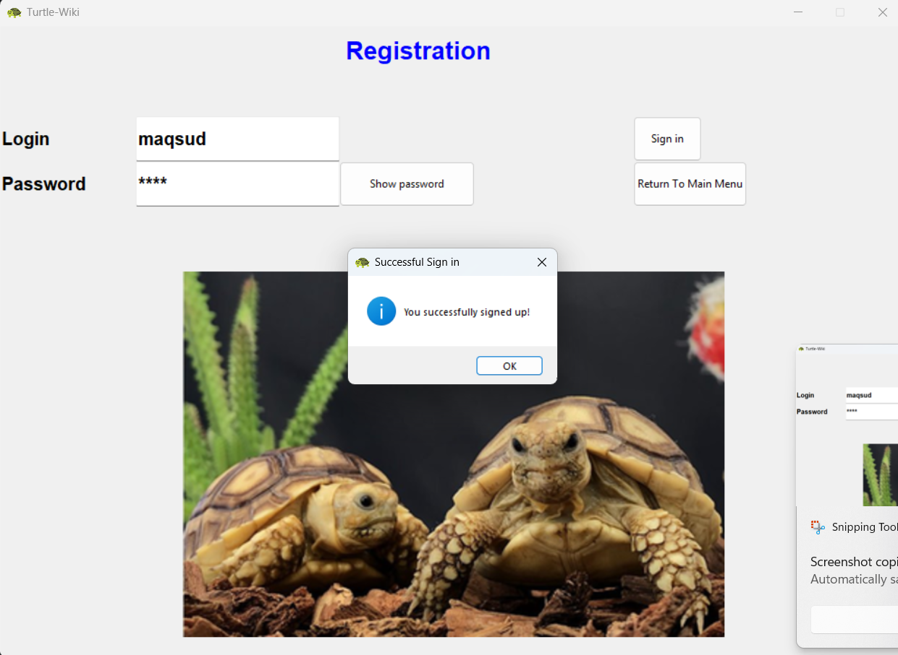
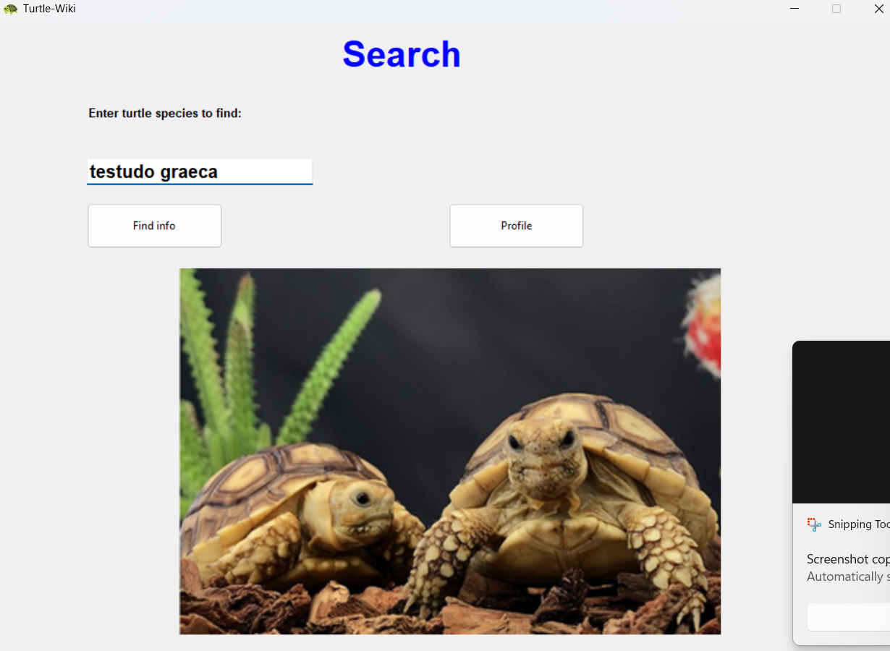
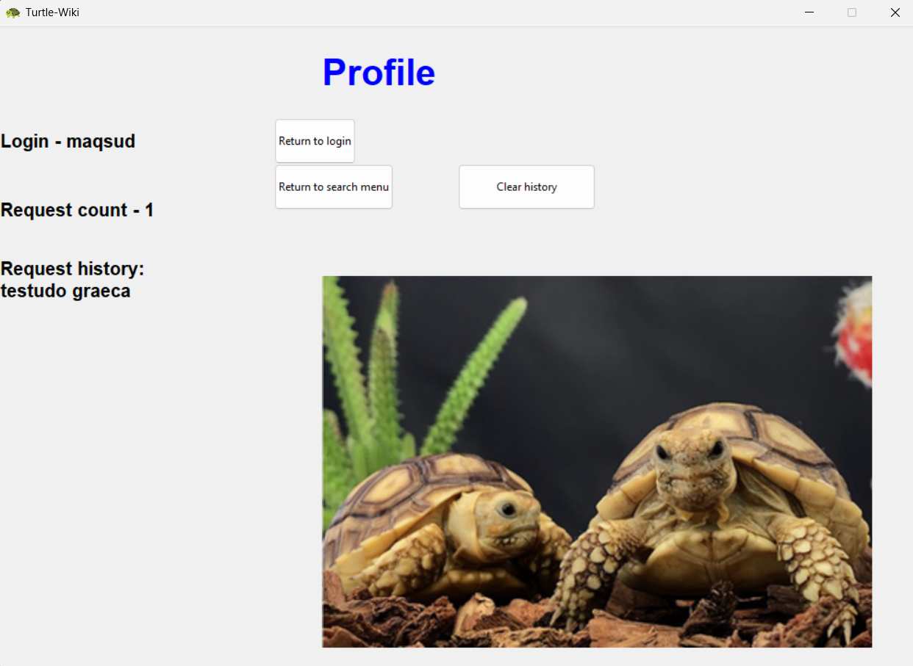

# Turtle-Wiki

A Python desktop application for searching information about turtle species. It gets taxon data from the iNaturalist API, finds the related Wikipedia article, and shows a short description and a photo.

## Screenshots







## Features

- Search by species name.
- View the scientific and common name, rank, taxon ID, and a link to Wikipedia.
- View a short description and a photo in a separate scrollable window.
- Local registration, login, and search history.

The main window contains the login, registration, search, and profile screens. Search results open in a separate window. Account data and search history are stored locally in the `users` file and are not synchronized between computers.

## Technologies

- Python 3
- Tkinter for the graphical interface
- [iNaturalist API](https://www.inaturalist.org/pages/api+reference)
- Wikipedia
- `requests` for HTTP requests
- Beautiful Soup (`beautifulsoup4`) for HTML parsing
- ImageMagick for converting the downloaded photo from JPG to PNG

`tkinter`, `json`, `os`, `re`, `subprocess`, and `textwrap` are part of the Python standard library. ImageMagick is a separate program and is not included in this repository. The project runs `ImageMagick/magick.exe`.

## Running on Windows

1. Install Python 3.
2. Download the portable Windows version of ImageMagick from the official website and put its contents into a folder named `ImageMagick` in the project root, so that `ImageMagick/magick.exe` exists.
3. Open a terminal in the project folder.
4. Install the third-party Python packages:

   ```powershell
   py -m pip install requests beautifulsoup4
   ```

5. Run the program from the project folder:

   ```powershell
   py turtle_wiki.py
   ```

Always run the program from the project root folder, where the images and the `ImageMagick` folder are located.

## Data files

On the first launch, the application creates a `users` file in the current folder if it does not exist yet. It stores accounts and search history locally.

## Images

The application uses `turtle_ico.png`, `turtle_image.png`, and `sulcata_image.png` from the project folder. During a search, the photo is downloaded from iNaturalist, and then ImageMagick converts it for display.
